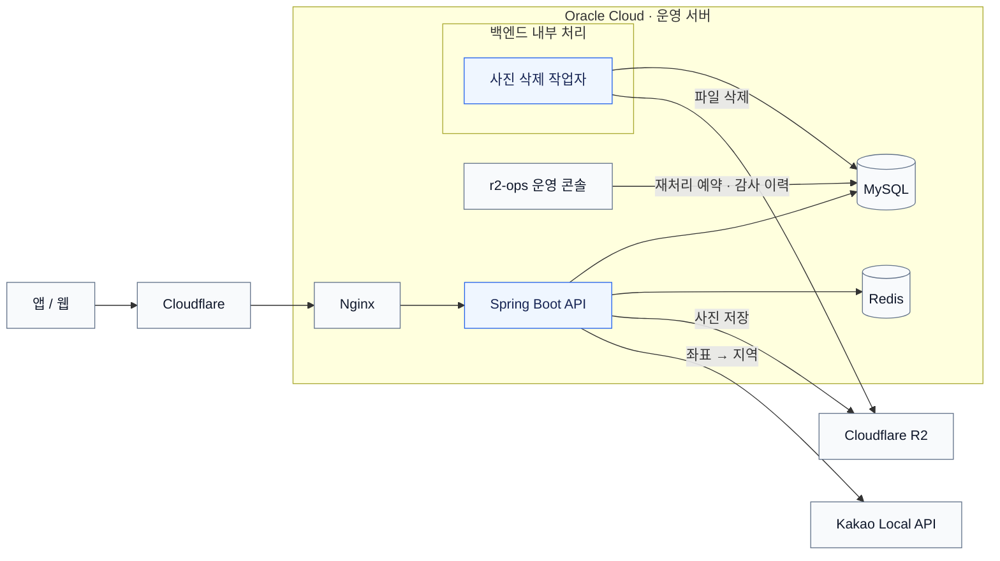
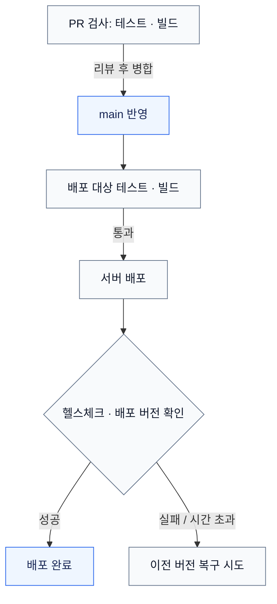

# 여기닷 (Yeogidot) Backend

사진의 촬영 시간과 위치를 바탕으로 여행을 정리하는 서비스의 REST API 서버입니다.
사진 업로드부터 날짜별 여행 기록, 지도 조회, 공개 링크 공유까지 지원합니다.

**사용 흐름:** 사진 업로드 → 여행 구성 → 지도·날짜별 기록 → 공유

## 참여 범위

| 구분 | 내용 |
| --- | --- |
| 개발 기간 | 2025.11.25 ~ 현재 |
| 팀 구성 | 2026.02까지 3인 공동 개발 |
| 공동 개발 당시 담당 | 사진 업로드·조회, 여행 기능 확장, 배포 자동화 참여 |
| 이후 담당 | 2026.03부터 백엔드 개발·배포·운영 단독 담당 |
| 주요 개선·검증 | 2026.09 ~ 2026.10 |

## 기술 스택

| 구분 | 기술 |
| --- | --- |
| 백엔드 | Java 21, Spring Boot, Spring Security, Spring Data JPA |
| 데이터 | MySQL, Redis |
| 인프라·저장소 | Oracle Cloud, Nginx, Cloudflare R2 |
| CI/CD | GitHub Actions |

## 시스템 구성

- **MySQL:** 사용자·여행·사진 메타데이터·일기·댓글과 삭제 작업, 감사 이력 저장
- **Redis:** 역지오코딩 캐시, 로그인 시도 제한, 로그아웃 토큰 차단
- **R2:** 이미지 파일 저장. 앱은 API가 반환한 사진 URL로 이미지를 별도 조회
- **삭제 작업자:** 별도 서버 없이 백엔드 내부에서 실행. 운영 콘솔은 파일을 직접 삭제하지 않고 작업을 예약

## 주요 문제 해결

### 1. 사진 삭제 실패 복구

DB에서 사진 정보는 지워졌지만 R2 파일은 남고, 재처리할 기록도 없는 상황을 테스트에서 재현했습니다. 파일을 먼저 삭제해도 이후 DB 처리에 실패하면 복원할 수 없어, 삭제 순서를 바꾸는 대신 재처리할 작업을 DB에 남겼습니다. 사진 정보 삭제와 파일 삭제 작업 저장을 같은 DB 트랜잭션으로 묶고, 커밋 후 내부 작업자가 파일을 삭제하도록 구성했습니다(Transactional Outbox 방식).

작업자는 선점 유효기간과 토큰을 사용합니다. 처리 중 중단되면 만료 후 다시 선점하고, 선점 토큰으로 이전 작업자의 뒤늦은 DB 상태 변경을 막습니다. 실패 시 간격을 늘려 재시도하며, 한도를 넘긴 작업은 `FAILED`로 보관합니다. 원인 조치 후 운영 콘솔에서 재처리를 예약하고, 요청 UUID로 중복 반영을 막아 감사 이력을 남깁니다.

| 검증 환경 | 결과 |
| --- | --- |
| H2·모의 저장소 | DB 롤백 시 사진·파일 유지. 파일 기반 H2에서는 네 시점 JVM 강제 종료 후 새 JVM에서 작업 복구 확인 |
| 로컬 MySQL·단일 JVM의 두 스레드 | 단일 작업·배치 경쟁을 각각 10회 반복해 중복 선점 없음 확인 |
| 로컬 MySQL·실제 테스트용 R2 | HTTP 요청 전 실패 주입 1회. 수동 재처리 후 파일 삭제·완료, 같은 UUID 재전송에도 감사 이력 1건 |

**적용 범위:** 단일 사진 삭제. 여행 전체 삭제·회원 탈퇴는 별도 경로이며, 다중 서버와 실제 R2 통신 장애는 검증하지 않았습니다. 파일 삭제는 중복 실행될 수 있어 명시적인 파일 없음 응답은 완료로 처리합니다.

[삭제 복구 PR #39](https://github.com/yeogidot/yeogidot-backend/pull/39) · [수동 복구 PR #43](https://github.com/yeogidot/yeogidot-backend/pull/43) · [동시 선점 검증 PR #47](https://github.com/yeogidot/yeogidot-backend/pull/47)

### 2. 역지오코딩 중복 호출 제거

시·도, 시·군·구, 상세 조회가 다른 캐시 키를 사용하고, 내부 호출이 `@Cacheable` 프록시를 거치지 않아 같은 좌표를 중복 조회했습니다. 상세 지역 정보를 공통 캐시로 공유하고, 같은 인스턴스의 동시 요청은 진행 중인 결과를 함께 사용하도록 변경했습니다(Single-flight). 실패·빈 결과는 캐시하지 않습니다.

| 실제 Redis·Kakao API 비교 | 개선 전 | 개선 후 |
| --- | ---: | ---: |
| 같은 좌표를 세 조회 메서드에서 사용 | 3회 | 1회 |
| 빈 캐시에 같은 좌표 동시 요청 3개 | 3회 | 1회 |

캐시를 비우고 시나리오별·버전별 1회 실행해 반환 지역 정보가 같음을 확인했습니다. 개선 전 동시 호출 수는 실행 타이밍에 따라 달라질 수 있습니다. 요청 공유는 같은 인스턴스 안에서만 적용됩니다.

[캐시 구현·검증 PR #37](https://github.com/yeogidot/yeogidot-backend/pull/37)

### 3. 여행 상세 조회 방식 비교

여행·일차·사진·댓글·일기를 한 번에 조인하면 결과 행이 늘어날 수 있어 네 단계로 나눠 Fetch Join합니다. 기존 구현을 같은 응답 DTO를 만드는 비교용 지연 로딩 코드와 측정했습니다.

| 측정 항목 | 비교용 지연 로딩 | 분리 Fetch Join |
| --- | ---: | ---: |
| SQL 실행 횟수 | 222회 | 4회 |
| 처리 시간 중앙값 | 약 57.2ms | 약 15.8ms |

로컬 MySQL, 여행 1개·10일·사진 200장·댓글 600건·로그 10건 기준입니다. 방식별 워밍업 10회 후 50회씩 3차례 측정한 통합 중앙값입니다. Repository 조회부터 DTO 생성까지의 **조회 방식 비교**이며, 운영 API 개선 전후나 HTTP 응답 시간 비교가 아닙니다.

[조회 비교 검증 PR #35](https://github.com/yeogidot/yeogidot-backend/pull/35)

## CI/CD

PR에서는 운영 자격 증명 없이 테스트와 빌드를 수행합니다. `main`에 반영되면 배포할 커밋을 다시 검사하고, 생성된 JAR를 서버에 전달합니다.

- **배포 전 확인:** 테스트·빌드 실패 시 배포 중단. 등록한 SSH 호스트 키와 전송 파일의 체크섬·JAR 무결성 확인
- **배포 충돌 방지:** GitHub Actions 동시 실행 제한과 서버의 `flock` 잠금 사용
- **배포 확인:** `/health/ready`가 요청 수신 준비 상태와 배포 버전을 반환. DB·Redis·R2 상태를 종합 검사하는 엔드포인트는 아님
- **복구 범위:** 이전 JAR·운영 콘솔·배포 버전 기록 복원. 복구 후 헬스체크에 실패하면 수동 조치 필요. 재시작 중 서비스가 중단되며 DB 변경은 복구하지 않음
- **검증:** 2026.10.29 운영 배포에서 HTTP 200과 새 버전 일치 확인. 시작 실패·시간 초과·롤백은 테스트 환경에서 검증

외부 서비스 연동 테스트와 벤치마크는 별도로 실행합니다. 자동 복구는 배포 중 실패에만 적용됩니다.
[배포 개선 PR #49](https://github.com/yeogidot/yeogidot-backend/pull/49)
